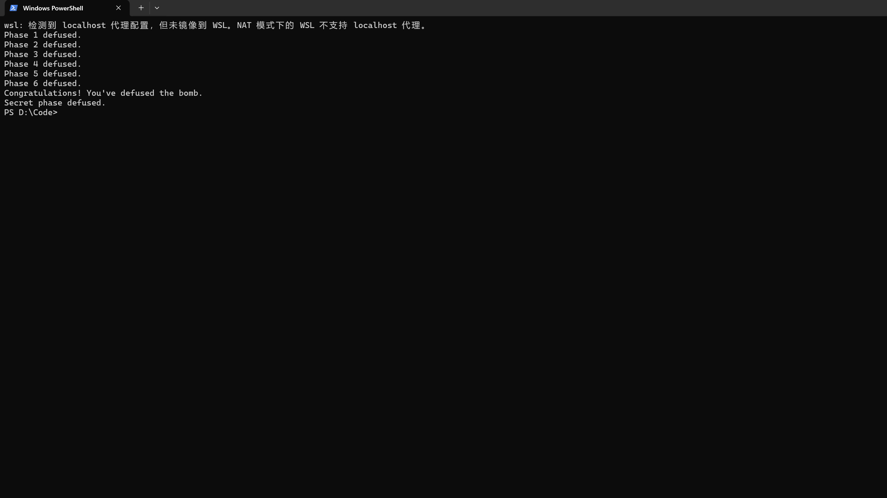

# BombLab 实验报告

## 环境与约定

在 Ubuntu 22.04 x86-64 中分析个人炸弹。下文 `c` 表示关卡 challenge，`lo32` 表示截取低 32 位；除特别说明外，计算均为无符号 32 位，自动按模 2³² 回绕。汇编采用 Intel 语法，下面摘录的是对应计算的关键指令。

## 第 1 关：函数调用

```asm
shr rax, 0x20          ; 高 32 位
shr rsi, 0x10
call p1_step1
call p1_step0
call p1_step2
cmp [rbp-0x14], eax
```

`p1_step1` 计算 `3*(hi - lo32(c>>16))+0xdc2c`，`p1_step0` 计算 `lo32(c) ^ (hi+0xb4db)`，`p1_step2` 将后者乘 2，再加上前者与 `0x4797` 的异或。比较指令表明口令是这一结果。

## 第 2 关：数组与递推

```asm
shr rax, 0x21
and eax, 0x1f
lea eax, [rax+rax*2]
; 循环中
lea esi, [rsi+rsi*2]
sub esi, edx
shr rax, cl
and eax, 0x3f
add eax, 0xb
xor eax, esi
```

`valid_u32_fields` 和 `sscanf` 要求 6 个数。首项 `v[0]=3*((c>>33)&31)`；`i=1..5` 时，`v[i]=(3*v[i-1]-i) ^ (((c>>(4+3*i))&63)+11)`。循环每次把前一个输入作为下一次递推的起点。

## 第 3 关：跳转表

```asm
and edi, 0x7
cmp [rbp-0x18], edi
shr rax, 0x3
shr rsi, 0x20
xor esi, eax
call p3_dispatch
notrack jmp QWORD PTR [rax*8+0x405820]
```

第一项 `k=c&7`，第二项由 `x=lo32(c>>3)^lo32(c>>32)` 决定。检查跳转表得到实际顺序为 case 6、2、1、0、5、3、7、4；不能直接按辅助函数编号排列。

| k | 第二项 |
|---|---|
| 0 | `(2*x)^0xf9f` |
| 1 | `5*x+0x5d57` |
| 2 | `(x^0x9af9)+(x>>1)` |
| 3 | `(2*x)^0x599c` |
| 4 | `5*x+0x2e883` |
| 5 | `5*x+0x2b917` |
| 6 | `5*x+0xd7f0` |
| 7 | `(x^0x9ec4)+(x>>2)` |

## 第 4 关：递归

```asm
shr edi, 1
add edi, esi          ; mid = lo + (hi-lo)/2
cmp edi, eax
call p4_walk
lea eax, [rax+rax*4]
xor eax, ebx
xor eax, 0x13         ; 左分支；右分支为 0x17
```

目标 `x=c&127`，初始区间 `[0,127]`，`salt=lo32(c>>7)^lo32(c>>32)`。中点等于目标时返回 `(mid+0x31)^salt`；否则递归进入对应半区，返回 `5*子结果 ^ (mid+salt) ^ 分支常量`，左、右分支常量分别为 `0x13`、`0x17`。口令是最外层返回值。

## 第 5 关：链表

```asm
and eax, 0x7
mov rdx, QWORD PTR [rax*8+0x405b60]
mov esi, DWORD PTR [rdx+0x4]
lea eax, [rax+rax*2]
add eax, DWORD PTR [rdx]
xor eax, esi
mov rdx, QWORD PTR [rdx+0x8]
```

根据偏移确定节点布局为 `value`、`tag`、`next`。头指针由 `c&7` 索引，后续走 `(c>>3)&3` 步，因此包括起始节点共处理 1 至 4 个节点。初值 `a=lo32(c>>6)^lo32(c>>32)^0xae5a`，每访问节点更新 `a=(3*a+value)^tag`；口令为最终 `a` 和最后节点的 `tag`。节点值及链接从只读数据区还原，具体表见 `defuser.c`。

## 第 6 关：函数指针表

```asm
and eax, 0x7
call QWORD PTR [rax*8+0x405e00]
xor eax, 0xb38
call QWORD PTR [rbx+0x405e00]
add eax, 0x8b25
```

初值 `x=lo32(c>>6)^lo32(c>>32)`；先用 `c&7` 选操作，再将结果异或 `0xb38`，用 `(c>>3)&7` 选第二个操作，最后加 `0x8b25`。函数表顺序为右旋 2、左旋 7 后异或 `0xea9`、`(x^0x6591)+8*x`、右旋 2、`((x<<5)+0x95e6)^(5*x)`、`(x+0x3a06)^(x>>1)`、`(x^(x>>7))+0x2b7a`、`(x^0x6591)+8*x`。

## Honor

```asm
cmp DWORD PTR [rbp-0xb0], 0x4e45504f  ; OPEN
lea rdi, [rbp-0xac]
call secret_phase
and ecx, 0x3
call secret_mix
xor eax, r9d
```

`secret_gate` 将整行复制到缓冲区，检查偏移 32 处的 `OPEN`，再从偏移 36 开始解析三个无符号整数。因此构造 32 个 `A`、`OPEN` 和三个数字。令 `a=lo32(challenge)^lo32(challenge>>32)`，`b=lo32(context)^lo32(context>>32)`，`k=lo32(context)&3`，`x=a^b`，则

```text
y = ((x ^ 0x691c) + ((x >> 3) ^ 0x1719)) ^ (k * 0x691c) ^ lo32(context >> 16)
z = y ^ (b + k + 0x1719 + (a >> 3))
```

三个数字依次为 `k y z`。根据两次比较还原 `y` 和 `z`，`context` 使用驱动根据六关答案计算的值。

## 验证记录

公开测试结果：正式六关 `60/60`，Honor `10/10`。另用公开列表之外的 seed **43**，一次验证全部关卡与 Honor：

```sh
{ ./defuser --seed 43; ./defuser --secret --seed 43; } | ./bomb --seed 43
```

实际输出摘录：

```text
Phase 1 challenge: 0x9cde98852e60034b
Phase 1 defused.
Phase 2 challenge: 0x6ec624aa85685867
Phase 2 defused.
Phase 3 challenge: 0xd49ffe504bfdab7f
Phase 3 defused.
Phase 4 challenge: 0x006ff81b72d591ff
Phase 4 defused.
Phase 5 challenge: 0x18e47d0995aecbfe
Phase 5 defused.
Phase 6 challenge: 0x523fb4dd5d162e88
Phase 6 defused.
Congratulations! You've defused the bomb.
Secret phase defused.
```

以下为 seed 43 实际运行结果的 PowerShell 截图，输出经过 `grep defused` 筛选：



## 参考资料与辅助工具

参考资料：课程 BombLab 作业说明与仓库 README。辅助工具：GDB 和 objdump 用于分析汇编与数据布局；gcc、课程提供的 public_test.py 和 bomb 用于编译及验证；AI 工具用于核对报告要求与测试结果。
